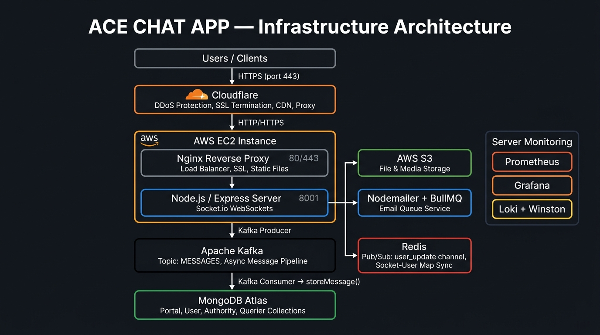
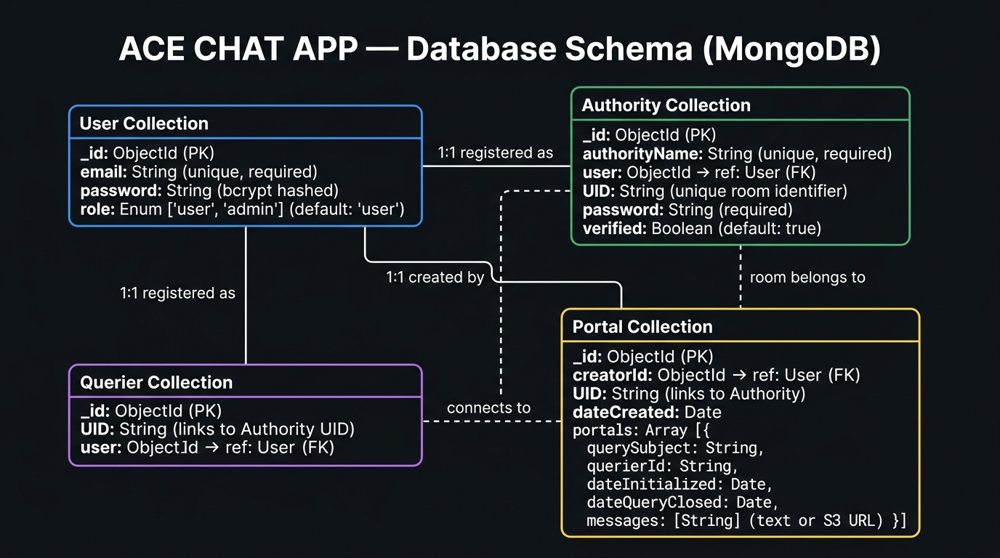
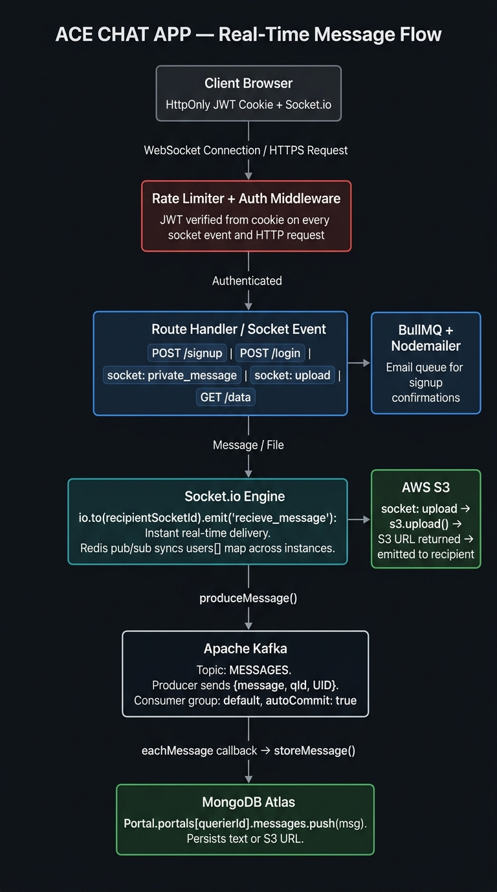

<div align="center">

# 💬 ACE Chat App
### *A Real-Time Private Chat Platform — AdvoTalk*

[](https://nodejs.org)
[](https://expressjs.com)
[](https://socket.io)
[](https://mongodb.com)
[](https://redis.io)
[](https://kafka.apache.org)
[](https://aws.amazon.com/ec2/)
[](https://aws.amazon.com/s3/)
[](https://cloudflare.com)

</div>

---

## 📖 Overview

**ACE Chat App** (AdvoTalk) is a production-grade, real-time private chat platform built for secure, room-based communication between **Authorities** (room creators/admins) and **Queriers** (users joining a room). Built with a fully event-driven architecture using **Socket.io** for real-time WebSocket messaging, **Apache Kafka** for async message persistence, **Redis** for pub/sub across processes, and **AWS S3** for file sharing — all deployed on **AWS EC2** behind **Cloudflare** and **Nginx**.

---

## 🏗️ Infrastructure Architecture

> Traffic flows through **Cloudflare** (edge proxy + DDoS) → **Nginx** (reverse proxy / load balancer on EC2) → **Node.js/Express** on port 8001. Real-time chat is handled via **Socket.io** WebSockets. Messages are asynchronously persisted via an **Apache Kafka** pipeline (producer → consumer → MongoDB). File uploads go directly to **AWS S3** via the socket. **Redis** pub/sub synchronizes the in-memory socket-user map across server instances.



| Layer | Technology | Role |
|---|---|---|
| Edge | Cloudflare | DDoS protection, SSL termination, CDN proxy |
| Server | AWS EC2 | Virtual machine hosting the application |
| Reverse Proxy | Nginx | Load balancer, SSL termination, port 80/443 → 8001 |
| Runtime | Node.js (ES Modules) | Application server |
| API | Express.js 4.21 | REST + static file serving |
| Real-time | Socket.io 4.7 | WebSocket private messaging |
| Message Queue | Apache Kafka (KafkaJS) | Async message persistence pipeline |
| Cache / Pub-Sub | Redis | Cross-process socket-user map sync |
| File Storage | AWS S3 | Chat file/image uploads |
| Emailing | Nodemailer + BullMQ | Welcome emails with async queue |
| Monitoring | Prometheus + Grafana + Loki | Metrics, dashboards, structured logs |
| Logging | Winston + winston-loki | Structured logs shipped to Loki |
| Containerization | Docker | Prometheus, Kafka, Zookeeper services |

---

## 🗄️ Database Schema

> All persistent data lives in **MongoDB Atlas** via Mongoose. Four collections model the domain: `Users`, `Authority`, `Querier`, and `Portal` (chat rooms with message history).



### Collections

#### 👤 User
```js
{
  email    : String   // unique, required
  password : String   // bcrypt hashed (10 salt rounds)
  role     : Enum     // 'user' | 'admin' (default: 'user')
}
```

#### 🏛️ Authority (Room Creator)
```js
{
  authorityName : String   // unique, required — the room name/code
  user          : ObjectId // ref → User
  UID           : String   // unique room identifier, generated on verification
  password      : String   // required
  verified      : Boolean  // default: true
}
```

#### 🙋 Querier (Room Joiner)
```js
{
  UID  : String   // required — the Authority's UID they are connecting to
  user : ObjectId // ref → User
}
```

#### 🚪 Portal (Chat Room + Message History)
```js
{
  creatorId   : ObjectId  // ref → User (the authority)
  UID         : String    // links to Authority's UID
  dateCreated : Date
  portals     : [{
    querySubject      : String  // topic/subject of the query
    querierId         : String  // the Querier's user ID
    dateInitialized   : Date
    dateQueryClosed   : Date
    messages          : [String] // text messages or AWS S3 file URLs
  }]
}
```

---

## 🔄 Real-Time Message Flow



```
Client (Authority/Querier)
  |
  |-- socket.emit('register-admin' | 'register-user')
  |     └-- JWT verified from cookie → added to in-memory users[] map
  |     └-- Redis pub/sub broadcasts user registration to all instances
  |
  |-- socket.emit('private_message', { message })
  |     |-- JWT verified → sender role determined
  |     |-- Recipient socket ID looked up in users[]
  |     |-- io.to(recipientSocketId).emit('recieve_message') [real-time delivery]
  |     └-- produceMessage() → Kafka topic "MESSAGES"
  |                            └-- Consumer → storeMessage() → MongoDB Portal
  |
  └-- socket.emit('upload', { fileBuffer, originalname, mimetype })
        |-- JWT verified
        |-- File uploaded directly to AWS S3
        |-- S3 URL emitted to recipient via socket
        └-- S3 URL produced to Kafka → stored in Portal.messages
```

---

## 🛣️ API Endpoints

### Auth
| Method | Endpoint | Auth | Description |
|--------|----------|------|-------------|
| `POST` | `/signup` | ❌ | Register new user. Redirects authority → generateRoom, querier → joinRoom. |
| `POST` | `/login` | ❌ | Validate credentials, set `accessToken` + `refreshToken` HttpOnly cookies. |
| `POST` | `/logout` | ❌ | Clear auth cookies. |

### Room Management
| Method | Endpoint | Auth | Description |
|--------|----------|------|-------------|
| `POST` | `/generateRoom` | ✅ | Authority creates a new room (Portal + Authority doc), gets a UID. |
| `POST` | `/joinRoom` | ✅ | Querier joins a room by entering Authority's UID. Creates Querier doc. |

### Data
| Method | Endpoint | Auth | Description |
|--------|----------|------|-------------|
| `GET` | `/data` | ✅ | Fetch chat history from Portal for the logged-in user's session. |

### Pages (SSR HTML)
| Route | Auth | Description |
|-------|------|-------------|
| `GET /` | ❌ | Home page |
| `GET /signup` | ❌ | Sign-up page |
| `GET /login` | ❌ | Login page |
| `GET /chat` | ✅ | Chat page (adminChat.html for authority, userChat.html for querier) |
| `GET /dashboard` | ✅ | Authority dashboard page |
| `GET /userLogin` | ✅ | Create query page |
| `GET /metrics` | ❌ | Prometheus metrics endpoint |

### WebSocket Events
| Event | Direction | Description |
|-------|-----------|-------------|
| `register-admin` | Client → Server | Register authority's socket, broadcast via Redis |
| `register-user` | Client → Server | Register querier's socket |
| `private_message` | Client → Server | Send text message (real-time + Kafka async persist) |
| `upload` | Client → Server | Upload file to S3, broadcast URL + Kafka persist |
| `recieve_message` | Server → Client | Deliver message/file URL to recipient |
| `disconnect` | Client → Server | Cleanup user from in-memory map |

---

## 🧩 Project Structure

```
Ace-chat-app/
├── docs/                            # Architecture diagrams
│   ├── ace_infrastructure.jpg
│   ├── ace_db_schema_dark.jpg
│   └── ace_request_flow.jpg
└── ACE-Web/
    ├── docker-compose.yml           # Prometheus (+ Kafka/Zookeeper config)
    ├── prometheus-config.yml        # Prometheus scrape config
    ├── kafka.txt                    # Kafka setup notes
    ├── package.json                 # Dependencies (ES modules)
    ├── public/                      # Static frontend
    │   ├── views/                   # HTML pages (home, chat, dashboard...)
    │   ├── scripts/                 # Client-side JS
    │   ├── assets/                  # Images, fonts
    │   └── *.css                    # Page stylesheets
    └── Server/
        ├── app.js                   # Express + Socket.io entrypoint
        └── src/
            ├── db/
            │   └── mongoose.js            # MongoDB Atlas connection
            ├── models/
            │   ├── user.model.js          # User collection
            │   ├── authority.model.js     # Authority (room creator) collection
            │   ├── querier.model.js       # Querier (room joiner) collection
            │   └── portal.model.js        # Portal (chat room + messages)
            ├── schemas/
            │   ├── user.schema.js         # Zod validation
            │   └── UID.schema.js          # UID validation
            ├── routes/
            │   ├── authRoutes.js          # /signup /login /generateRoom /joinRoom
            │   ├── dataRoute.js           # /data — fetch chat history
            │   └── logoutroute.js         # /logout
            ├── middleware/
            │   ├── authMiddleware.js      # JWT verify, token generators
            │   ├── kafka.js               # Kafka producer, consumer, storeMessage
            │   └── rateLimiterMiddleware.js
            └── utils/
                ├── email.js               # Nodemailer email sender
                ├── jwtUtils.js            # JWT sign/verify helpers
                └── template.html          # Email HTML template
```

---

## ⚙️ Key Technical Decisions

### 🔐 Authentication
- **JWT (jsonwebtoken)** stored as **HttpOnly, SameSite=Strict cookies** — XSS-safe.
- JWT payload includes `{ _id, role, UID, adminId }` for RBAC and room routing.
- Socket events also verify JWT from cookie before any operation.

### ⚡ Real-Time Architecture
- **Socket.io** WebSockets for instant private message delivery between paired Authority and Querier sockets.
- In-memory `users[]` array tracks `{adminId, adminSocketId, userId, userSocketId}` pairs.
- **Redis pub/sub** (`user_update` channel) synchronizes this map across multiple Node.js processes/instances.

### 📨 Async Message Persistence (Kafka Pipeline)
- Every message (text or S3 URL) is produced to Kafka topic `"MESSAGES"`.
- A dedicated **Kafka consumer** (`groupId: "default"`) reads messages and calls `storeMessage()` to persist into MongoDB `Portal.portals[].messages`.
- This decouples real-time delivery from database I/O, preventing DB latency from affecting chat.

### 🗂️ File Sharing (AWS S3)
- Files are uploaded directly via the WebSocket `upload` event (buffer transferred).
- Uploaded to S3 bucket at `uploads/<timestamp>_<filename>`.
- The S3 public URL is then emitted to the recipient and persisted via Kafka.

### 📊 Observability Stack
- **Prometheus**: Scrapes `/metrics` endpoint. Tracks `http_express_req_res_time` histogram (method, route, status_code buckets).
- **Grafana**: Dashboard over Prometheus data.
- **Loki + Winston**: Structured application logs shipped via `winston-loki` transport to Loki at port 3100.

---

## 🚀 Getting Started (Local Dev)

### Prerequisites
- Node.js 18+
- MongoDB Atlas URI
- Redis running locally
- Apache Kafka + Zookeeper (or use Docker)
- AWS account (S3 bucket + IAM credentials)
- Gmail app password (for emails)

### Environment Variables
Create a `.env` file in `ACE-Web/`:
```env
MONGODB_URI=mongodb+srv://<user>:<pass>@cluster.mongodb.net/ace
SECRET_KEY=your_jwt_secret
PORT=8001
AWS_REGION=ap-south-1
AWS_ACCESS_KEY_ID=your_key_id
AWS_SECRET_ACCESS_KEY=your_secret
S3_BUCKET_NAME=your_bucket_name
EMAIL_PASSWORD=your_gmail_app_password
```

### Run Services
```bash
# Start Prometheus via Docker
docker-compose up -d

# Install dependencies
cd ACE-Web && npm install

# Start Kafka (see kafka.txt for setup)

# Start dev server
npm start
# Runs on http://localhost:8001
```

---

## 🏛️ Tech Stack

| Category | Technology |
|---|---|
| **Runtime** | Node.js (ES Modules) |
| **API Framework** | Express.js 4.21 |
| **Real-Time** | Socket.io 4.7 |
| **Message Queue** | Apache Kafka (KafkaJS 2.2) |
| **Cache / Pub-Sub** | Redis 4.7 |
| **Database** | MongoDB Atlas + Mongoose 8 |
| **File Storage** | AWS S3 (aws-sdk v3) |
| **Auth** | JWT (jsonwebtoken) + bcrypt |
| **Validation** | Zod |
| **Email** | Nodemailer + BullMQ |
| **Metrics** | Prometheus (prom-client) + Grafana |
| **Logging** | Winston + winston-loki → Loki |
| **Security** | Helmet, HttpOnly cookies |
| **Containerization** | Docker |
| **Reverse Proxy** | Nginx |
| **Cloud** | AWS EC2 + AWS S3 |
| **Edge/CDN** | Cloudflare |

---

## 🎓 About

**ACE Chat App** is the backend for the **AdvoTalk** platform — a secure, private chat solution connecting authorities (lawyers, advisors, service providers) with queriers (clients) through isolated, monitored chat rooms.

---

<div align="center">

Made with ⚡ by **AdvoTalk**

</div>
